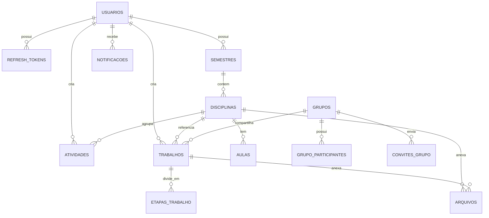

# Banco de Dados e Migrations Flyway — UniFlow Backend

> **SGBD**: PostgreSQL | **Versionamento**: Flyway (`src/main/resources/db/migration/`)
> **Estado Atual**: `2` migrations criadas e aplicadas/validadas em `PostgreSQL 16.15` via Testcontainers + Hibernate `validate` (`V1__init_baseline.sql` e `V2__create_usuarios_table.sql`).

---

## 1. Convenções de Modelagem

- **Chaves Primárias**: `UUID` gerado pela aplicação ou `gen_random_uuid()`.
- **Timestamps**: Sempre `TIMESTAMPTZ` (armazenando UTC, conforme `RNF-016`).
- **Horários recorrentes de aula**: `VARCHAR` para dia da semana + `TIME` para `hora_inicial` e `hora_final`.
- **Enums**: `VARCHAR(40)` com `CHECK` constraint (facilita evoluções sem `ALTER TYPE`).
- **Hibernate**: `spring.jpa.hibernate.ddl-auto=validate` em desenvolvimento/produção (somente Flyway altera o schema).
- **Regra `ATRASADA` (`Épico 6`)**: O estado `ATRASADA` de atividades é calculado dinamicamente com base em `prazo` e conclusão, não dependendo de atualização batch persistida no banco.

---

## 2. Diagrama Entidade-Relacionamento Alvo (MVP 1.0 + v1.1)

---

## 3. Plano de Migrations Flyway

| Versão | Arquivo Planejado | Tabelas / Objetos | Tarefa | Status |
| :--- | :--- | :--- | :--- | :--- |
| `V1` | `V1__init_baseline.sql` | Extensões base / baseline inicial (`pgcrypto`) | `BE-004` | `CONCLUIDA` |
| `V2` | `V2__create_usuarios_table.sql` | `usuarios` (`uk_usuarios_email`, `ck_usuarios_status`), `refresh_tokens` (`uk_refresh_tokens_token_hash`, `fk_refresh_tokens_usuario`, `fk_refresh_tokens_replaced_by`) | `BE-015` | `CONCLUIDA (PostgreSQL + Hibernate validate)` |
| `V3` | `V3__create_semestres_table.sql` | `semestres` + índice único parcial `WHERE atual = true` | `BE-034` | `PENDENTE` |
| `V4` | `V4__create_disciplinas_table.sql` | `disciplinas` | `BE-047` | `PENDENTE` |
| `V5` | `V5__create_aulas_table.sql` | `aulas` + `CHECK (hora_inicial < hora_final)` | `BE-060` | `PENDENTE` |
| `V6` | `V6__create_atividades_table.sql` | `atividades` + índices `(usuario_id, status, prazo)` | `BE-074` | `PENDENTE` |
| `V7` | `V7__create_trabalhos_table.sql` | `trabalhos`, `etapas_trabalho` (`ordem`, `prazo`) | `BE-092` | `PENDENTE` |
| `V8` | `V8__create_grupos_tables.sql` | `grupos`, `grupo_participantes`, `convites_grupo` *(v1.1)* | `BE-123` | `PENDENTE` |
| `V9` | `V9__create_arquivos_table.sql` | `arquivos` *(somente metadados + `storage_key`, v1.1)* | `BE-133` | `PENDENTE` |
| `V10` | `V10__create_notificacoes_table.sql` | `notificacoes` *(v1.1)* | `BE-139` | `PENDENTE` |
| `V11` | `V11__create_assinaturas_tables.sql` | `planos`, `assinaturas`, `pagamentos` *(v2.0 — bloqueado)* | `BE-152` | `FORA_DO_MVP` |

---

## 4. Constraints e Índices Críticos

1. **`usuarios`**: `PRIMARY KEY (id)` UUID, `UNIQUE (email)` (`uk_usuarios_email`) + `ck_usuarios_email_lowercase` (`email = LOWER(email)`), `status VARCHAR(40)` com `ck_usuarios_status` (`ATIVO`, `INATIVO`, `BLOQUEADO`, `EXCLUIDO`), `created_at`/`updated_at` em `TIMESTAMPTZ` e índice `idx_usuarios_status`.
2. **`refresh_tokens`**: `PRIMARY KEY (id)` UUID, `token_hash` único (`uk_refresh_tokens_token_hash`), `fk_refresh_tokens_usuario` (`ON DELETE CASCADE`), `expires_at` (`TIMESTAMPTZ`), `revoked`, `revoked_at`, `replaced_by_token_id` (`fk_refresh_tokens_replaced_by`, `ON DELETE SET NULL`) e índices `idx_refresh_tokens_usuario_id`, `idx_refresh_tokens_expires_at`, `idx_refresh_tokens_usuario_revoked` (suporte à rotação segura `BE-024`).
3. **`semestres`**:
   - `CONSTRAINT ck_semestres_datas CHECK (data_inicial < data_final)`
   - `CREATE UNIQUE INDEX uq_semestre_atual_usuario ON semestres (usuario_id) WHERE atual = true`
4. **`aulas`**: `CONSTRAINT ck_aulas_horario CHECK (hora_inicial < hora_final)`.
5. **`atividades`**:
   - `CONSTRAINT ck_atividades_tempo_positivo CHECK (tempo_estimado_minutos IS NULL OR tempo_estimado_minutos > 0)`
   - Índice composto `(usuario_id, status, prazo)` para filtro eficiente de pendentes, atrasadas (via `prazo < now()`) e concluídas.
6. **`etapas_trabalho`**: índice `(trabalho_id, ordem)` para ordenação determinística (`BE-105`).
7. **`arquivos`**: sem colunas `BYTEA` / `OID` (regra estrita do `MOD-10`).
