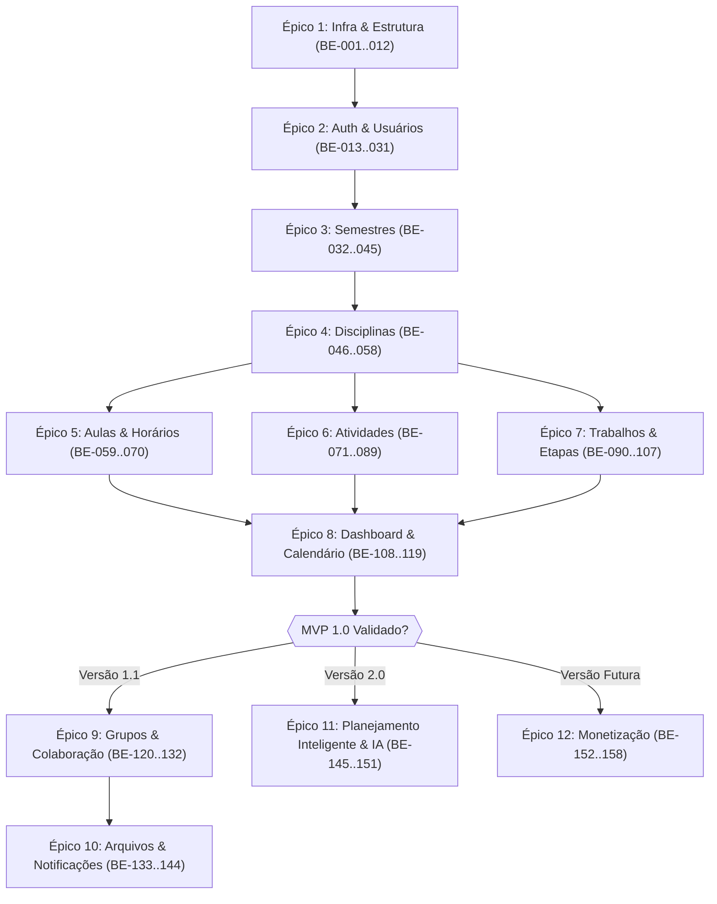

# Roadmap, Dependências e Rastreabilidade — UniFlow Backend

Este documento consolida a estratégia de entregas do backend (`uniflow-backend`) pelos **12 Épicos (`BE-001`..`BE-158`)** em [BACKLOG.md](file:///c:/uniflow_api/api/docs/BACKLOG.md) e a matriz de rastreabilidade com os requisitos do **Documento Mestre** (`RF-001`..`RF-092`, `RNF-001`..`RNF-017`).

---

## 1. Estratégia de Versões

| Versão | Épicos | Faixa de Tarefas | Qtd. | Regra de Governança |
| :--- | :--- | :--- | :---: | :--- |
| **MVP 1.0** | Épicos 1 a 8 | `BE-001`..`BE-119` | 119 | Prioridade inicial: concluir Épico 1 antes dos módulos funcionais |
| **Versão 1.1** | Épicos 9 e 10 | `BE-120`..`BE-144` | 25 | Grupos, colaboração, arquivos e notificações |
| **Versão 2.0** | Épico 11 | `BE-145`..`BE-151` | 7 | **Bloqueado até validação do MVP 1.0** |
| **Versão Futura** | Épico 12 | `BE-152`..`BE-158` | 7 | **Bloqueado até validação comercial do MVP** |

---

## 2. Grafo de Dependências entre Épicos

---

## 3. Matriz de Rastreabilidade (`RF` / `RNF` -> `BE-XXX`)

### Requisitos Funcionais

| Módulo | Requisitos | Tarefa(s) no Backlog Oficial | Versão |
| :--- | :--- | :--- | :--- |
| `MOD-01` Autenticação | `RF-001` Cadastro | `BE-013`..`BE-020`, `BE-031` | `MVP 1.0` |
| `MOD-01` Autenticação | `RF-002` Login e-mail/senha | `BE-018`, `BE-022`, `BE-023`, `BE-024`, `BE-025`, `BE-031` | `MVP 1.0` |
| `MOD-01` Autenticação | `RF-003` Logout | `BE-026`, `BE-031` | `MVP 1.0` |
| `MOD-01` Autenticação | `RF-004` Atualizar senha | `BE-029` | `MVP 1.0` |
| `MOD-01` Autenticação | `RF-005` Recuperar senha | *Sem `BE-XXX` dedicado no backlog atual (adicionar se autorizado)* | *Backlog futuro* |
| `MOD-01` Autenticação | `RF-006` Consultar usuário autenticado | `BE-027` | `MVP 1.0` |
| `MOD-01` Autenticação | `RF-007` Proteger endpoints privados | `BE-021`, `BE-022`, `BE-030` | `MVP 1.0` |
| `MOD-02` Usuários | `RF-008`, `RF-009` Consultar/atualizar perfil | `BE-027`, `BE-028` | `MVP 1.0` |
| `MOD-02` Usuários | `RF-010`, `RF-011` Preferências notif. e excluir conta | *Sem `BE-XXX` dedicado no backlog atual (adicionar se autorizado)* | *Backlog futuro* |
| `MOD-03` Semestres | `RF-012`..`RF-017` CRUD, excluir e semestre atual | `BE-032`..`BE-045` | `MVP 1.0` |
| `MOD-03` Semestres | `RF-018` Informações consolidadas | `BE-039`, `BE-108`..`BE-113` | `MVP 1.0` |
| `MOD-04` Disciplinas | `RF-019`..`RF-025` CRUD, professor, carga horária | `BE-046`..`BE-058` | `MVP 1.0` |
| `MOD-04` / `MOD-05` | `RF-026`..`RF-031` Horários de aulas e grade semanal | `BE-059`..`BE-070` | `MVP 1.0` |
| `MOD-06` Atividades | `RF-032`..`RF-044` CRUD, status, conclusão, filtros, prazo, atrasos | `BE-071`..`BE-089`, `BE-113` | `MVP 1.0` |
| `MOD-07` Calendário | `RF-045`..`RF-051` Calendário consolidado (aulas, atividades, trabalhos) | `BE-114`..`BE-119` | `MVP 1.0` |
| `MOD-08` Trabalhos | `RF-052`..`RF-062` Trabalhos, etapas, progresso e prazos | `BE-090`..`BE-107` | `MVP 1.0` |
| `MOD-09` Grupos | `RF-063`..`RF-070` Grupos, convites, papéis, compartilhamento | `BE-120`..`BE-132` | `Versão 1.1` |
| `MOD-10` Arquivos | `RF-071`..`RF-074` Upload, download, exclusão, associação | `BE-133`..`BE-138`, `BE-144` | `Versão 1.1` |
| `MOD-11` Notificações | `RF-075`..`RF-078` Gerar, listar, marcar lida e alertas de prazo | `BE-139`..`BE-144` | `Versão 1.1` |
| `MOD-11` Notificações | `RF-079` Configurar preferências de notificação | *Vinculado a `RF-010` (aguarda definição no backlog se necessário)* | *Backlog futuro* |
| `MOD-12` Planejamento | `RF-080`..`RF-086` Sessões de estudo manuais | *Não incluído no backlog oficial `BE-001`..`158` (apenas IA no Épico 11)* | *Backlog futuro* |
| `MOD-12` Planejamento IA | Cronograma inteligente e priorização | `BE-145`..`BE-151` | `Versão 2.0` |
| `MOD-13` Assinaturas | `RF-087`..`RF-092` Planos, limites, pagamento, cancelamento | `BE-152`..`BE-158` | `Versão Futura` |

> **Nota (Regra 16)**: Os itens `RF-005`, `RF-010`, `RF-011`, `RF-079` e `RF-080`..`RF-086` presentes em `REQUIREMENTS.md` não possuem tarefa `BE-XXX` atribuída na lista oficial `BE-001`..`BE-158` e só devem ser implementados caso autorizados pelo usuário.

### Requisitos Não Funcionais

| Código | Descrição | Tarefa(s) / Escopo |
| :--- | :--- | :--- |
| `RNF-001` | API REST seguindo padrões HTTP | `BE-007`, `BE-008`, controllers |
| `RNF-002` | Autenticação segura (JWT + refresh rotation) | `BE-021`..`BE-026`, `BE-030` |
| `RNF-003` | Autorização em todos os recursos privados | `BE-021`, `BE-030`, `BE-057`, `BE-131` |
| `RNF-004` | Validação de dados no backend | `BE-009`, `BE-044`, `BE-106`, `BE-138` |
| `RNF-005` | Senhas armazenadas com hash seguro (BCrypt) | `BE-020` |
| `RNF-006` | Banco PostgreSQL | `BE-003` |
| `RNF-007` | Versionamento do banco com Flyway | `BE-004`, `BE-015`, `BE-034`, `BE-047`, `BE-060`, `BE-074`, `BE-092`, `BE-123`, `BE-133`, `BE-139`, `BE-152` |
| `RNF-008` | Documentação com OpenAPI/Swagger | `BE-010` |
| `RNF-009` | Tratamento padronizado de exceções (Problem Details) | `BE-007`, `BE-008` |
| `RNF-010` | Testes unitários e de integração | `BE-012`, `BE-031`, `BE-045`, `BE-058`, `BE-070`, `BE-089`, `BE-107`, `BE-119`, `BE-132`, `BE-144`, `BE-151`, `BE-158` |
| `RNF-011` | Interface responsiva | *Escopo Frontend (`uniflow-frontend`) — N/A neste repositório* |
| `RNF-012` | Paginação em consultas que possam crescer | `BE-038`, `BE-051`, `BE-078`, `BE-096`, `BE-141` |
| `RNF-013` | Logs estruturados | `BE-011` |
| `RNF-014` | Proteção contra acesso indevido a dados | `BE-030`, `BE-056`, `BE-057`, `BE-130`, `BE-131` |
| `RNF-015` | Configurações sensíveis via variáveis de ambiente | `BE-003`, `BE-006` |
| `RNF-016` | Compatibilidade com fusos horários | `BE-006`, `BE-086`, `BE-114`..`BE-117` |
| `RNF-017` | Acessibilidade básica e navegação por teclado | *Escopo Frontend (`uniflow-frontend`) — N/A neste repositório* |
